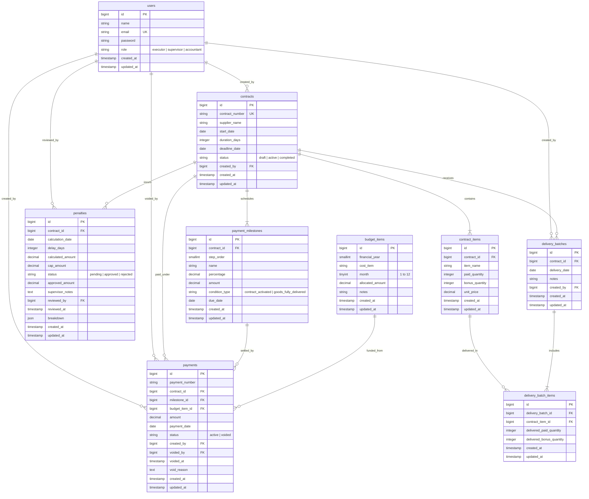

# Ma’lumotlar bazasi strukturasi (ERD - Entity Relationship Diagram)

Quyida tizimdagi jadvallar, ularning maydonlari va o‘zaro munosabatlari aks ettirilgan.

---

## Jadvallar tavsifi

1. **`users`**: Tizim foydalanuvchilari. `role` ustuni (`executor`, `supervisor`, `accountant`) orqali tizimdagi huquqlar belgilanadi.
2. **`contracts`**: Shartnomaning asosiy kartochkasi. Holatlari: `draft` (Qoralama), `active` (Faol), `completed` (Yakunlangan).
3. **`contract_items`**: Shartnoma tovarlari. Pullik miqdor (`paid_quantity`) va bepul bonus miqdor (`bonus_quantity`) alohida saqlanadi.
4. **`delivery_batches` & `delivery_batch_items`**: Kelgan tovarlar partiyasi. Qaysi sanada qancha pullik va qancha bonus tovar kelganligi saqlanadi.
5. **`penalties`**: Shartnoma bo‘yicha hisoblangan jarima yozuvi. Hisoblash sanasi, kechikkan kunlar, hisoblangan va limit (50%) summalari, rahbar tasdig‘i (`approved_amount`) hamda kun-kunlik breakdown JSON formatida saqlanadi.
6. **`payment_milestones`**: Shartnomaning to‘lov bosqichlari (Avans 30%, Yetkazib berish 70%). Bosqich holati saqlanmaydi, balki to‘lov reestri asosida doimiy dinamik hisoblanadi.
7. **`budget_items`**: Smeta qatorlari. Yil, xarajat moddasi va oy bo‘yicha ajratilgan byudjet mablag‘lari. `(financial_year, cost_item, month)` bo‘yicha noyob cheklov o‘rnatilgan.
8. **`payments`**: To‘lovlar reestri. Yozuvlar hech qachon o‘chirilmaydi. Xato bo‘lsa `status = 'voided'` qilinadi va `void_reason` hamda `voided_by` qayd etiladi.
