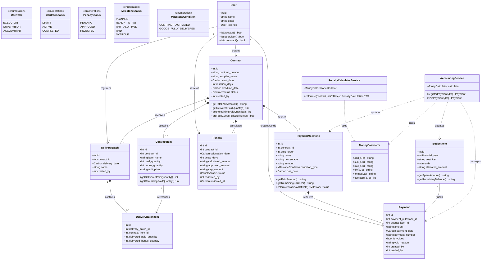

# UML Class Diagram (Диаграмма классов)

Диаграмма классов отображает ключевые доменные модели, сервисы, перечисления (Enums) и объекты передачи данных (DTO), а также связи между ними.

---

## Диаграмма классов доменной модели (Mermaid)

---

## Архитектурные слои
1. **Models & Enums:** Строго типизированные сущности Eloquent, инкапсулирующие расчетные свойства (`getTotalPaidAmount`, `getRemainingBalance`, `arePaidGoodsFullyDelivered`).
2. **DTO (Data Transfer Objects):** Гарантия чистоты входных данных между контроллерами и сервисами без утечки сырых HTTP-массивов.
3. **Services:** Изолированная бизнес-логика (расчет неустойки, 5-ступенчатая валидация оплат, пессимистические блокировки).
4. **MoneyCalculator:** Базовый математический компонент на базе `bcmath`, защищающий систему от ошибок точности чисел с плавающей точкой (`float`).
