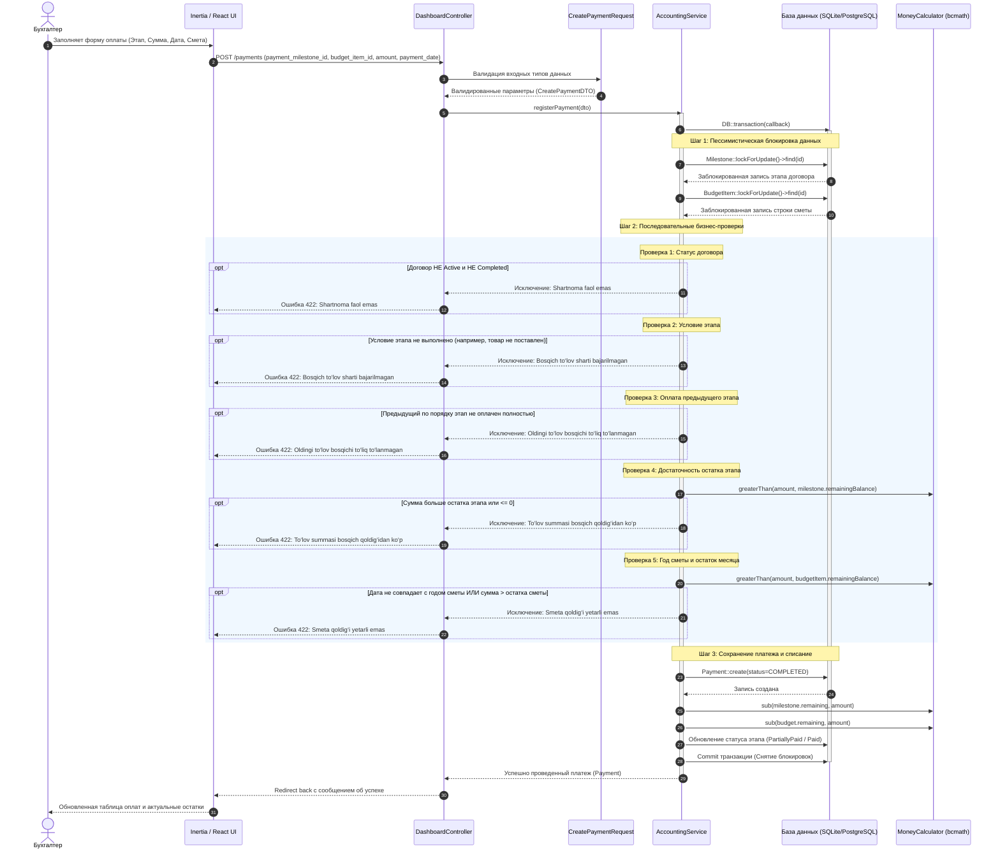

# UML Sequence Diagram: Проведение платежа (Payment Workflow)

Диаграмма последовательности отображает процесс регистрации платежа бухгалтером с 5-ступенчатой последовательной валидацией, пессимистической блокировкой строк на уровне базы данных (`lockForUpdate`) и автоматическим пересчетом остатков этапов и сметы.

---

## Диаграмма последовательности (Mermaid)

---

## Ключевые гарантии процесса
1. **Атомарность:** Все операции происходят внутри `DB::transaction()`. В случае ошибки на любой из 5 проверок транзакция полностью откатывается.
2. **Защита от Race Condition:** Строки этапа и сметы блокируются через `lockForUpdate()`, исключая двойное списание средств при одновременных запросах.
3. **Строгая последовательность:** Нарушение хотя бы одного из 5 правил немедленно прерывает выполнение на первом сработавшем условии.
