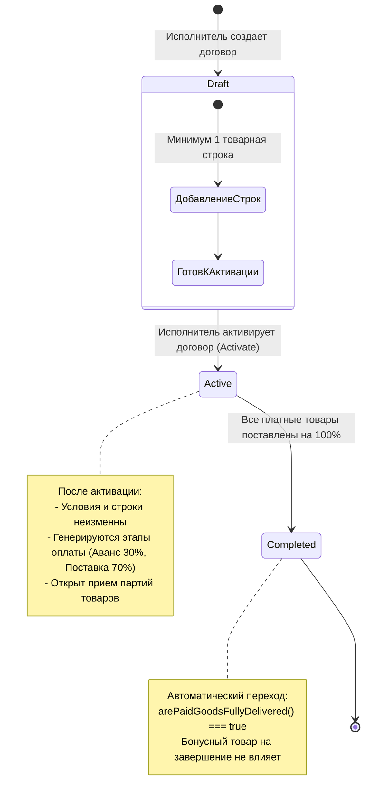
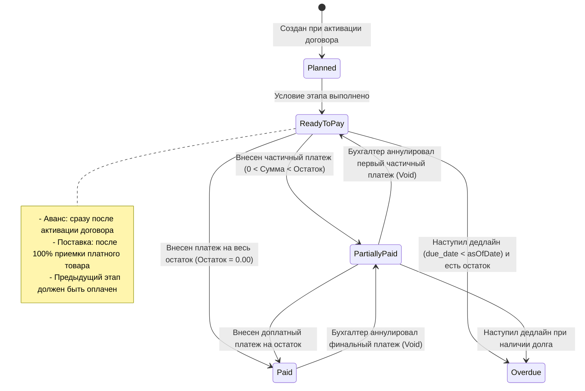
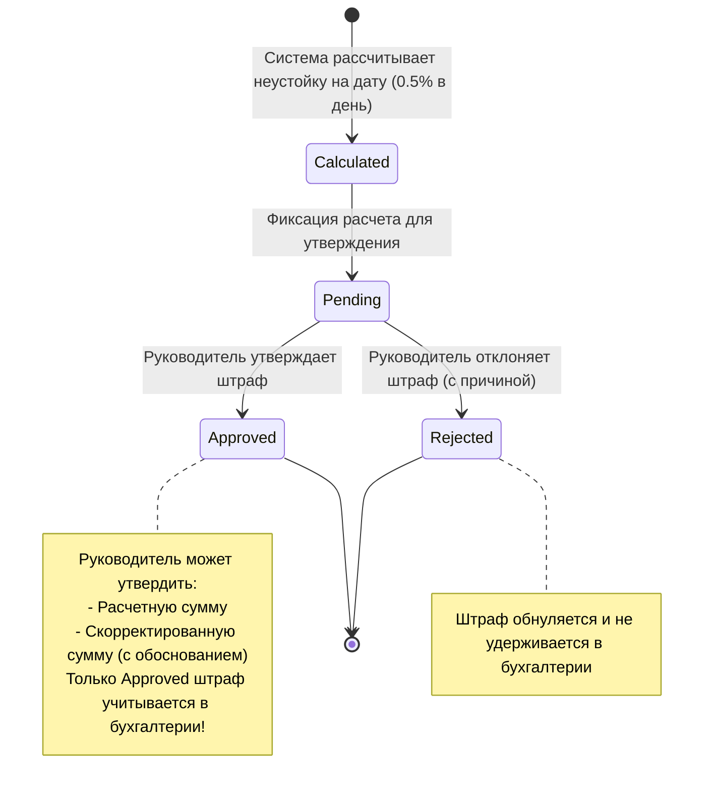
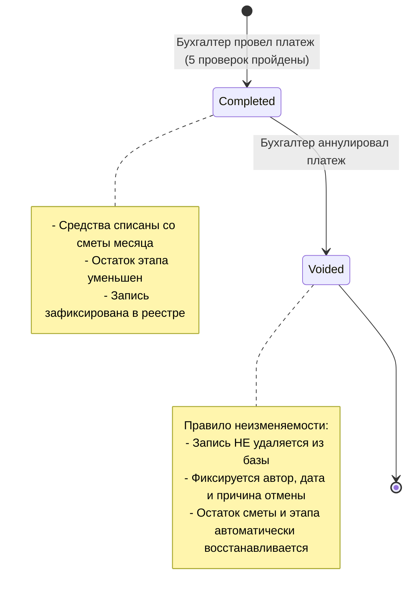

# UML State Machine Diagrams (Диаграммы состояний)

Диаграммы конечных автоматов демонстрируют жизненный цикл ключевых доменных сущностей системы: договоров, этапов оплаты, штрафов и платежей.

---

## 1. Жизненный цикл договора (Contract Lifecycle)

---

## 2. Жизненный цикл этапа оплаты (Payment Milestone)

Статус этапа не меняется пользователем вручную — он динамически вычисляется движком на основе фактических данных реестра и поставок:

---

## 3. Жизненный цикл штрафа (Penalty Approval Lifecycle)

---

## 4. Жизненный цикл платежа (Payment Lifecycle)

