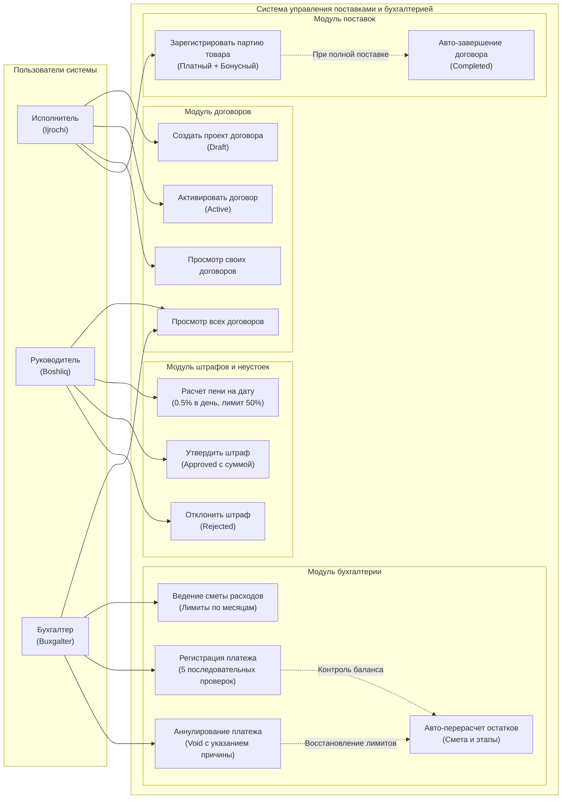

# UML Use Case Diagram (Диаграмма прецедентов использования)

Диаграмма прецедентов использования отображает роли пользователей системы государственных закупок и доступные им операции в соответствии с политиками безопасности (Policies & Gates).

## Актёры (Actors)
* **Исполнитель (Ijrochi):** Инициатор договора, отвечает за фиксацию условий и приемку фактически поступивших партий товаров.
* **Руководитель (Boshliq):** Контролирующий орган, принимает решения по штрафным санкциям и отслеживает все контракты организации.
* **Бухгалтер (Buxgalter):** Управляет сметными ассигнованиями (бюджетом), проводит платежи по этапам финансирования и аннулирует ошибочные проводки.

---

## Диаграмма прецедентов (Mermaid)

---

## Матрица прав доступа

| Прецедент (Use Case) | Исполнитель (Ijrochi) | Руководитель (Boshliq) | Бухгалтер (Buxgalter) |
| :--- | :---: | :---: | :---: |
| Создание договора (Draft) | Да | Нет | Нет |
| Активация договора (Active) | Да (свои) | Нет | Нет |
| Просмотр договоров | Только свои | Все | Все |
| Приемка партии товаров | Да (свои) | Нет | Нет |
| Расчет и предпросмотр пени | Да (просмотр) | Да | Да |
| Утверждение / отклонение пени | Нет | Да | Нет |
| Добавление строк сметы (Бюджет) | Нет | Нет | Да |
| Проведение оплаты по этапу | Нет | Нет | Да |
| Аннулирование платежа (Void) | Нет | Нет | Да |
